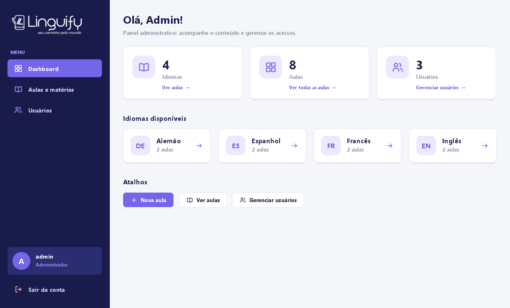
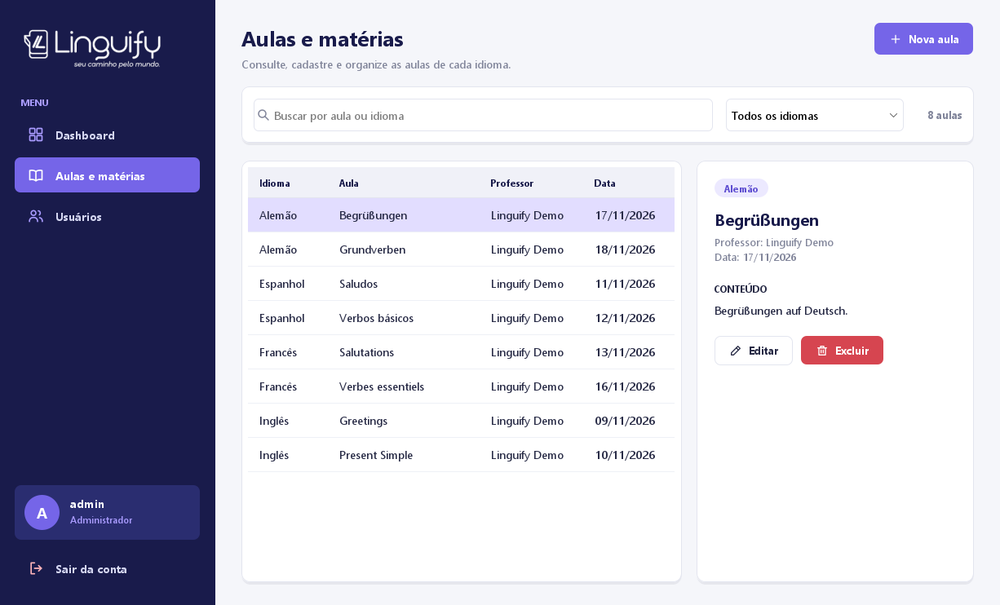
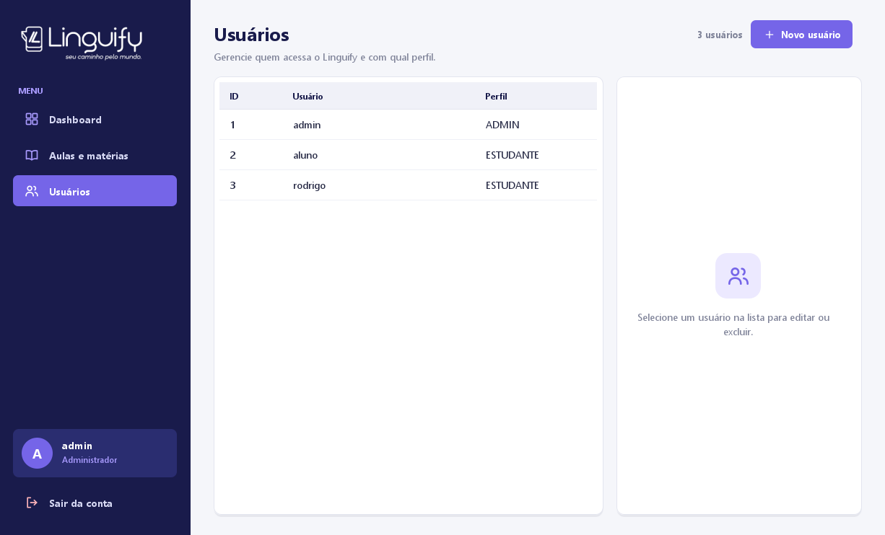

# Linguify

Aplicação desktop de **aprendizado de idiomas** feita em **Java Swing**, com **MySQL**, **Maven** e senhas protegidas com **BCrypt**.
O Linguify reúne aulas de Inglês, Espanhol, Francês e Alemão em um só lugar: estudantes consultam e pesquisam as aulas; administradores cadastram conteúdos e gerenciam usuários.

Projeto acadêmico, publicado como parte de um portfólio.

| Login | Dashboard (administrador) |
|---|---|
|  |  |

| Aulas e matérias | Usuários |
|---|---|
|  |  |

> As imagens foram geradas com dados fictícios de demonstração.

## Funcionalidades

- **Login e cadastro** de estudantes, com mostrar/ocultar senha, validações e mensagens claras. O cadastro público cria apenas contas `ESTUDANTE`.
- **Dashboard** com números reais do banco (idiomas, aulas e, para administradores, usuários), cards e atalhos que abrem as seções.
- **Aulas e matérias**: lista, busca por nome da aula ou idioma, filtro por idioma e detalhes da aula.
  Administradores também cadastram, editam e excluem aulas (com confirmação).
- **Usuários** (somente administradores): cadastro, edição de nome, perfil e senha, e exclusão. Nunca mostra senhas ou hashes.
- **Permissões** por perfil (`ADMIN` e `ESTUDANTE`) verificadas na interface **e** na camada de dados, que ainda reconfirma o perfil no banco a cada operação administrativa.
- Proteções: não é possível excluir a própria conta nem remover ou rebaixar o último administrador.

## Tecnologias

Java 21+ (testado com JDK 24) · Java Swing + [FlatLaf](https://www.formdev.com/flatlaf/) · MySQL 8 · Maven (wrapper incluído) · jBCrypt · JUnit 5.

## Requisitos

- **JDK 21 ou superior** (confira com `java -version`).
- **MySQL 8** instalado e em execução (por exemplo, MySQL Installer ou WAMP).
- Não é preciso instalar o Maven: o projeto traz o Maven Wrapper (`mvnw`), que baixa o Maven na primeira execução (precisa de internet).

## Como executar (instalação local)

Os comandos abaixo são para **Windows** (PowerShell ou Prompt de Comando), executados na pasta do projeto.
No **Linux/macOS**, use `./mvnw` no lugar de `mvnw.cmd`, `cp` no lugar de `copy` e `/` nos caminhos
(por exemplo, `target/linguify-jar-with-dependencies.jar`).

### 1. Criar o banco

Com o MySQL em execução:

```bash
mysql -u root -p < db/schema.sql
```

O script cria o banco `login` com as tabelas `usuario` e `materias` (somente a estrutura, sem dados).

### 2. Configurar a conexão com o banco

Por padrão o Linguify conecta em `localhost:3306`, banco `login`, usuário `root`, **sem senha**.
Se o seu MySQL usa outra senha ou outro endereço, crie o arquivo de configuração:

```bash
copy config.properties.example config.properties
```

Edite o `config.properties` com os seus valores (`db.url`, `db.user` e `db.password`).
Também é possível usar as variáveis de ambiente `LINGUIFY_DB_URL`, `LINGUIFY_DB_USER` e `LINGUIFY_DB_PASSWORD`,
que têm prioridade sobre o arquivo. O `config.properties` **não é versionado**.

### 3. Gerar o aplicativo (JAR)

```bash
mvnw.cmd clean package
```

Isso compila o projeto, executa os testes e gera o arquivo `target/linguify-jar-with-dependencies.jar`.
Para pular os testes e gerar mais rápido: `mvnw.cmd clean package -DskipTests`.

### 4. Criar os dados de demonstração

Cria três contas e oito aulas de idiomas. **Você escolhe as três senhas** (na ordem: `admin`, `aluno`, `rodrigo`);
elas ficam no banco somente como hash BCrypt. Use senhas com 6 ou mais caracteres.

```bash
java -cp target\linguify-jar-with-dependencies.jar util.CriarDadosDemo SENHA_ADMIN SENHA_ALUNO SENHA_RODRIGO
```

Troque `SENHA_ADMIN`, `SENHA_ALUNO` e `SENHA_RODRIGO` pelas senhas que quiser. Se tudo der certo, aparece:

```
Usuários criados: 3 (já existiam: 0)
Aulas criadas: 8
```

| Usuário | Perfil |
|---|---|
| `admin` | ADMIN |
| `aluno` | ESTUDANTE |
| `rodrigo` | ESTUDANTE |

Aulas criadas: Inglês (Greetings, Present Simple), Espanhol (Saludos, Verbos básicos), Francês (Salutations, Verbes essentiels) e Alemão (Begrüßungen, Grundverben).
A carga é segura para repetir: contas e aulas que já existem não são alteradas nem duplicadas.

### 5. Abrir o Linguify

```bash
java -jar target\linguify-jar-with-dependencies.jar
```

Na tela de login, entre com um dos usuários acima e a senha que você definiu no passo 4.
Também é possível criar uma conta de estudante pelo link **Criar conta**.

> Alternativa sem gerar o JAR: `mvnw.cmd exec:java` abre o aplicativo direto pelo Maven.

## Solução de problemas

- **"Não foi possível conectar ao banco de dados"**: confirme que o MySQL está em execução, que o banco `login` foi criado (passo 1) e que `db.url`, `db.user` e `db.password` estão corretos (passo 2).
- **`mysql` não é reconhecido como comando**: use o caminho completo do executável (por exemplo, em `bin` dentro da pasta de instalação do MySQL) ou execute o conteúdo de `db/schema.sql` no cliente gráfico que preferir.
- **"Usuários criados: 0 (já existiam: 3)"**: as contas já existiam; a carga não altera contas existentes. Para trocar uma senha, entre como `admin`, abra **Usuários** e edite a conta.
- **Erro de versão do Java** (`UnsupportedClassVersionError`): instale o JDK 21 ou superior.

## Testes

```bash
mvnw.cmd clean test
```

Os testes não precisam de MySQL: usam um banco falso em memória que reconhece exatamente os comandos SQL dos DAOs.
Os testes de interface precisam de ambiente gráfico (são ignorados automaticamente quando não há) e geram imagens de pré-visualização em `target/preview`.

## Estrutura do projeto

```
src/main/java
├── VIEW/   telas: LoginView, JanelaPrincipal, DashboardPanel, AulasPanel, UsuariosPanel e formulários
├── ui/     identidade visual reutilizável: Tema, componentes, ícones, diálogos
├── DAO/    acesso ao MySQL (UsuarioDAO, MateriasDAO, ConexaoDAO)
├── DTO/    objetos de transferência
├── auth/   sessão, perfis e regras de negócio (RegrasUsuario, RegrasAula)
└── util/   PasswordHasher (BCrypt) e CriarDadosDemo
src/test/java   testes automatizados (JUnit 5)
db/schema.sql   estrutura do banco de dados
docs/           capturas de tela usadas neste README
```

## Segurança

- Senhas armazenadas somente como hash BCrypt; nunca em texto puro.
- Credenciais do banco fora do código (`config.properties` ou variáveis de ambiente).
- Não publique backups do banco nem o arquivo `config.properties` (ambos já estão no `.gitignore`).
- Para uma demonstração pública, use um usuário do MySQL com acesso restrito ao banco `login`, não o `root`.

## Licença

Distribuído sob a licença MIT. Veja o arquivo [LICENSE](LICENSE).
